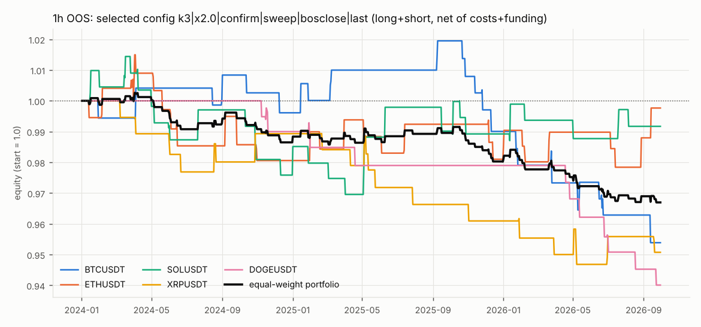
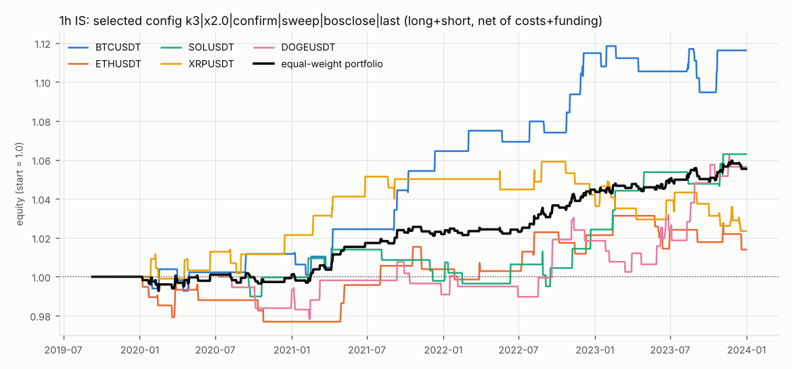
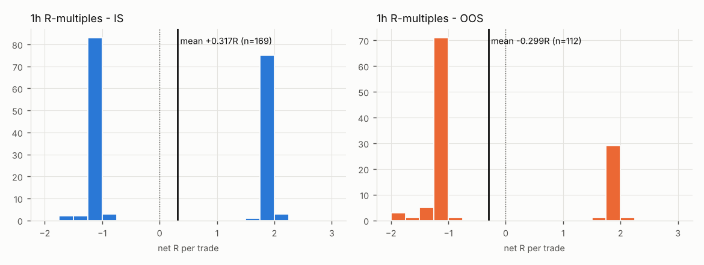
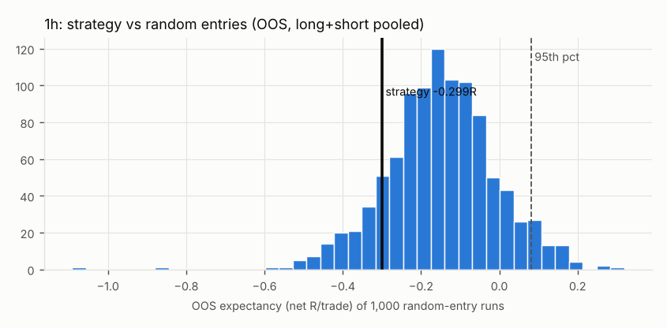
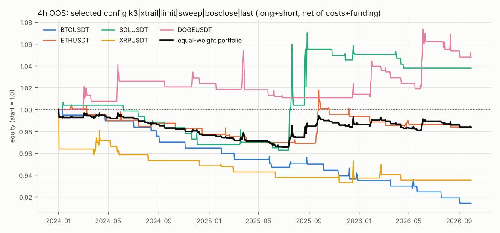
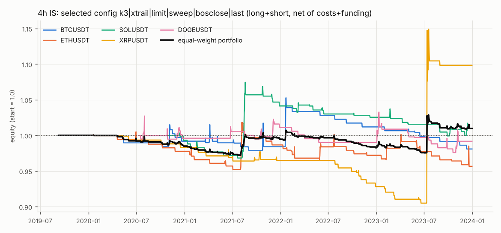
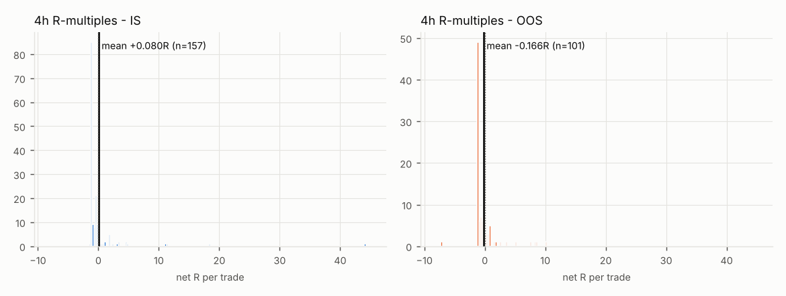
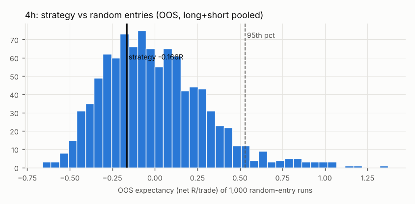

# Trend Pullback + Liquidity Sweep on USDⓈ-M perpetuals - backtest report

**Verdict: NO EDGE.** 1h: NO EDGE. 4h: NO EDGE.

- 1h: OOS expectancy is -0.299R/trade (not positive) over 112 trades; it ranks at the 12.5th percentile of random entries in the same trend regime (>= 95th required).
- 4h: OOS expectancy is -0.166R/trade (not positive) over 101 trades; it ranks at the 31.8th percentile of random entries in the same trend regime (>= 95th required).

Hypothesis tested: *in an established uptrend (downtrend), pullbacks into an unmitigated demand (supply) zone that first sweep a prior swing low (high) reach the fixed-R target more often than breakeven, net of fees, slippage and funding.* Universe: Binance USDⓈ-M perpetuals BTCUSDT, ETHUSDT, SOLUSDT, XRPUSDT, DOGEUSDT; 1h and 4h tested independently. Every number below is net of maker/taker fees, slippage and realized funding, and comes from exchange-published data (no synthetic data).

## 1. Headline (selected config, all symbols pooled; IS = data start → 2023-12-31, OOS = 2024-01-01 → 2026-09-30)

| TF | Window | Side | Trades | Win rate | Breakeven WR | Exp. R/trade | Exp. ex-funding | PF | Trades/mo | t-stat |
|---|---|---|---|---|---|---|---|---|---|---|
| 1h | IS | both | 169 | 46.7% | 36.3% | +0.317 | +0.322 | 1.54 | 3.3 | 2.71 |
| 1h | IS | long | 109 | 47.7% | 36.5% | +0.339 | +0.353 | 1.58 | 2.1 | 2.32 |
| 1h | IS | short | 60 | 45.0% | 35.8% | +0.278 | +0.265 | 1.46 | 1.2 | 1.41 |
| 1h | OOS | both | 112 | 27.7% | 37.4% | -0.299 | -0.298 | 0.64 | 3.4 | -2.27 |
| 1h | OOS | long | 63 | 30.2% | 37.6% | -0.228 | -0.222 | 0.72 | 1.9 | -1.27 |
| 1h | OOS | short | 49 | 24.5% | 37.0% | -0.390 | -0.396 | 0.55 | 1.5 | -2.01 |
| 4h | IS | both | 157 | 15.3% | 14.0% | +0.080 | +0.085 | 1.07 | 3.0 | 0.24 |
| 4h | IS | long | 75 | 17.3% | 10.6% | +0.538 | +0.574 | 1.71 | 1.4 | 0.80 |
| 4h | IS | short | 83 | 13.3% | 22.5% | -0.348 | -0.371 | 0.52 | 1.6 | -1.88 |
| 4h | OOS | both | 101 | 20.8% | 25.4% | -0.166 | -0.163 | 0.77 | 3.1 | -0.76 |
| 4h | OOS | long | 56 | 17.9% | 25.6% | -0.305 | -0.288 | 0.64 | 1.7 | -1.00 |
| 4h | OOS | short | 45 | 24.4% | 24.2% | +0.007 | -0.007 | 1.01 | 1.4 | 0.02 |

Selected on IS only (pooled over symbols, combined long+short runs, hypothesis rules fixed: sweep required, close-based BOS, last-price stop trigger); the OOS window was evaluated once with it:

- **1h**: `k3|x2.0|confirm|sweep|bosclose|last` - IS expectancy +0.317R over 169 trades.
- **4h**: `k3|xtrail|limit|sweep|bosclose|last` - IS expectancy +0.080R over 157 trades.

Config id format: `k<swing k>|x<R target or trail>|<entry>|<sweep>|<BOS rule>|<stop trigger>`.

## 2. Data

Sources: (1) the Binance public data archive (`data.binance.vision`, exchange-published monthly files, SHA-256 verified on download) from 2020-01; (2) for months between a perp's listing and the first archived month (BTCUSDT 2019-09..12, ETHUSDT 2019-11..12) the venue's public REST endpoints (`www.binance.com/fapi/v1`: klines, markPriceKlines, fundingRate; `fapi.binance.com` returns HTTP 451 from this environment). Ingest is idempotent (checksum / frame-digest skip, partition-atomic replace).

| Symbol | First bar (UTC) | First mark bar | First funding | Last bar | 1h bars | Missing last-price bars (logged) | Bars without mark price | Funding events |
|---|---|---|---|---|---|---|---|---|
| BTCUSDT | 2019-09-08 17:00 | 2019-12-23 11:00 | 2019-09-10 08:00 | 2026-09-30 23:00 | 61,903 | 0 | 2,754 | 7,733 |
| ETHUSDT | 2019-11-27 07:00 | 2019-12-23 11:00 | 2019-11-27 08:00 | 2026-09-30 23:00 | 59,993 | 0 | 700 | 7,499 |
| SOLUSDT | 2020-09-14 07:00 | 2020-09-13 11:00 | 2020-09-13 16:00 | 2026-09-30 23:00 | 52,865 | 120 | 192 | 6,700 |
| XRPUSDT | 2020-01-06 08:00 | 2020-01-06 03:00 | 2020-01-06 08:00 | 2026-09-30 23:00 | 58,912 | 120 | 192 | 7,379 |
| DOGEUSDT | 2020-07-10 09:00 | 2020-07-10 03:00 | 2020-07-10 08:00 | 2026-09-30 23:00 | 54,567 | 0 | 72 | 6,821 |

- History runs from each perp's listing (venue `onboardDate`) to 2026-09-30 23:00 UTC, the last complete month with klines, mark prices and funding published.
- The venue's mark-price history begins 2019-12-23 (the other three perps listed later and have mark prices from listing), so BTCUSDT/ETHUSDT bars before then have no mark price. No trade is opened on a bar without a mark price (those signals are skipped and counted), so BTCUSDT/ETHUSDT effectively trade from 2019-12-23. During later mark outages an already-open position's liquidation check uses last price for that bar (counted in §6). Last-price gaps are exchange outages; they are logged, never filled.
- Funding is the realized rate per event, with its timestamp; the interval is read from the data (`funding_interval_hours`, or the observed spacing where the venue omits it), not assumed.
- Open interest was not ingested (out of scope for this test).
- Instrument master cross-checked against the venue's exchangeInfo: listing date and current tick size match for 5/5 perps.
- Maintenance-margin tiers: taken from the venue's published tiers for 5/5 perps (public brackets endpoint), applied to the whole history because the venue publishes no tier history; the venue's maintenance amounts match the simulator's continuity formula for 5/5.

Coverage audit per symbol × dataset × interval (CLEANED layer; months by source: SHA-256-verified archive vs venue REST):

| Symbol | Dataset | Interval | First | Last | Rows | Missing bars | Archive months | REST months |
|---|---|---|---|---|---|---|---|---|
| BTCUSDT | klines | 1h | 2019-09-08 17:00 | 2026-09-30 23:00 | 61,903 | 0 | 81 | 4 |
| BTCUSDT | mark_klines | 1h | 2019-12-23 11:00 | 2026-09-30 23:00 | 59,149 | 216 | 81 | 1 |
| BTCUSDT | klines | 4h | 2019-09-08 16:00 | 2026-09-30 20:00 | 15,476 | 0 | 81 | 4 |
| BTCUSDT | mark_klines | 4h | 2019-12-23 08:00 | 2026-09-30 20:00 | 14,788 | 54 | 81 | 1 |
| BTCUSDT | funding | events | 2019-09-10 08:00 | 2026-09-30 16:00 | 7,733 | n/a | 81 | 4 |
| ETHUSDT | klines | 1h | 2019-11-27 07:00 | 2026-09-30 23:00 | 59,993 | 0 | 81 | 2 |
| ETHUSDT | mark_klines | 1h | 2019-12-23 11:00 | 2026-09-30 23:00 | 59,293 | 72 | 81 | 1 |
| ETHUSDT | klines | 4h | 2019-11-27 04:00 | 2026-09-30 20:00 | 14,999 | 0 | 81 | 2 |
| ETHUSDT | mark_klines | 4h | 2019-12-23 08:00 | 2026-09-30 20:00 | 14,824 | 18 | 81 | 1 |
| ETHUSDT | funding | events | 2019-11-27 08:00 | 2026-09-30 16:00 | 7,499 | n/a | 81 | 2 |
| SOLUSDT | klines | 1h | 2020-09-14 07:00 | 2026-09-30 23:00 | 52,865 | 120 | 73 | 0 |
| SOLUSDT | mark_klines | 1h | 2020-09-13 11:00 | 2026-09-30 23:00 | 52,813 | 192 | 73 | 0 |
| SOLUSDT | klines | 4h | 2020-09-14 04:00 | 2026-09-30 20:00 | 13,217 | 30 | 73 | 0 |
| SOLUSDT | mark_klines | 4h | 2020-09-13 08:00 | 2026-09-30 20:00 | 13,204 | 48 | 73 | 0 |
| SOLUSDT | funding | events | 2020-09-13 16:00 | 2026-09-30 16:00 | 6,700 | n/a | 73 | 0 |
| XRPUSDT | klines | 1h | 2020-01-06 08:00 | 2026-09-30 23:00 | 58,912 | 120 | 81 | 0 |
| XRPUSDT | mark_klines | 1h | 2020-01-06 03:00 | 2026-09-30 23:00 | 58,845 | 192 | 81 | 0 |
| XRPUSDT | klines | 4h | 2020-01-06 08:00 | 2026-09-30 20:00 | 14,728 | 30 | 81 | 0 |
| XRPUSDT | mark_klines | 4h | 2020-01-06 00:00 | 2026-09-30 20:00 | 14,712 | 48 | 81 | 0 |
| XRPUSDT | funding | events | 2020-01-06 08:00 | 2026-09-30 16:00 | 7,379 | n/a | 81 | 0 |
| DOGEUSDT | klines | 1h | 2020-07-10 09:00 | 2026-09-30 23:00 | 54,567 | 0 | 75 | 0 |
| DOGEUSDT | mark_klines | 1h | 2020-07-10 03:00 | 2026-09-30 23:00 | 54,501 | 72 | 75 | 0 |
| DOGEUSDT | klines | 4h | 2020-07-10 08:00 | 2026-09-30 20:00 | 13,642 | 0 | 75 | 0 |
| DOGEUSDT | mark_klines | 4h | 2020-07-10 00:00 | 2026-09-30 20:00 | 13,626 | 18 | 75 | 0 |
| DOGEUSDT | funding | events | 2020-07-10 08:00 | 2026-09-30 16:00 | 6,821 | n/a | 75 | 0 |

Mark-price availability, asked of the venue month by month between listing and the first mark bar (the absence is observed, not assumed):

| Symbol | Month | Mark bars returned | First mark bar |
|---|---|---|---|
| BTCUSDT | 2019-09 | 0 | - |
| BTCUSDT | 2019-10 | 0 | - |
| BTCUSDT | 2019-11 | 0 | - |
| BTCUSDT | 2019-12 | 205 | 2019-12-23 11:00 |
| ETHUSDT | 2019-11 | 0 | - |
| ETHUSDT | 2019-12 | 205 | 2019-12-23 11:00 |

Funding audit (reported interval vs observed spacing between consecutive events):

| Symbol | Events | With reported interval | Interval not reported (REST months) | Reported ≠ observed | Intervals seen (h) |
|---|---|---|---|---|---|
| BTCUSDT | 7,733 | 7,395 | 338 | 0 | 8 |
| ETHUSDT | 7,499 | 7,395 | 104 | 0 | 8 |
| SOLUSDT | 6,700 | 6,700 | 0 | 0 | 2, 4, 8 |
| XRPUSDT | 7,379 | 7,379 | 0 | 0 | 8 |
| DOGEUSDT | 6,821 | 6,821 | 0 | 0 | 8 |

Own-grid consistency: every stored 4h bar vs the 4h bar rebuilt from the stored 1h bars:

| Symbol | Dataset | 4h bars | Compared | Mismatches | First mismatch |
|---|---|---|---|---|---|
| BTCUSDT | klines | 15,476 | 15,475 | 4 | 2019-09-09 00:00:00+00:00 |
| BTCUSDT | mark_klines | 14,788 | 14,787 | 16 | 2020-01-03 04:00:00+00:00 |
| ETHUSDT | klines | 14,999 | 14,998 | 2 | 2019-12-11 16:00:00+00:00 |
| ETHUSDT | mark_klines | 14,824 | 14,823 | 16 | 2020-01-03 04:00:00+00:00 |
| SOLUSDT | klines | 13,217 | 13,216 | 1 | 2024-10-28 20:00:00+00:00 |
| SOLUSDT | mark_klines | 13,204 | 13,203 | 10 | 2020-12-01 16:00:00+00:00 |
| XRPUSDT | klines | 14,728 | 14,728 | 2 | 2020-01-16 20:00:00+00:00 |
| XRPUSDT | mark_klines | 14,712 | 14,711 | 15 | 2020-02-25 00:00:00+00:00 |
| DOGEUSDT | klines | 13,642 | 13,641 | 1 | 2024-10-28 20:00:00+00:00 |
| DOGEUSDT | mark_klines | 13,626 | 13,625 | 14 | 2020-07-17 12:00:00+00:00 |

81 of 143,207 4h bars differ from their 1h aggregate. These are inconsistencies between the exchange's own 1h and 4h series (around outages and fast markets, e.g. 2019-09-24 and 2024-10-28 20:00 UTC), not ingest errors. Each timeframe uses the venue's native series, and they are left as published.

Contract changes detected and applied as effective-dated instrument-master versions:

| Instrument | From | Change |
|---|---|---|
| binance_usdm.BTCUSDT.perp | 2019-09-01 00:00 | tick size observed from price precision (0.1 -> 0.01) |
| binance_usdm.BTCUSDT.perp | 2022-05-01 00:00 | tick size observed from price precision (0.01 -> 0.1) |
| binance_usdm.SOLUSDT.perp | 2020-09-01 00:00 | tick size observed from price precision (0.01 -> 0.0001) |
| binance_usdm.SOLUSDT.perp | 2021-06-01 00:00 | tick size observed from price precision (0.0001 -> 0.001) |
| binance_usdm.SOLUSDT.perp | 2022-02-01 00:00 | tick size observed from price precision (0.001 -> 0.01) |
| binance_usdm.SOLUSDT.perp | 2022-11-01 00:00 | tick size observed from price precision (0.01 -> 0.001) |
| binance_usdm.SOLUSDT.perp | 2025-03-01 00:00 | tick size observed from price precision (0.001 -> 0.01) |
| binance_usdm.SOLUSDT.perp | 2025-05-01 00:00 | tick size observed from price precision (0.01 -> 0.001) |
| binance_usdm.SOLUSDT.perp | 2025-06-01 00:00 | tick size observed from price precision (0.001 -> 0.01) |
| binance_usdm.SOLUSDT.perp | 2025-07-01 00:00 | tick size observed from price precision (0.01 -> 0.001) |
| binance_usdm.SOLUSDT.perp | 2025-09-01 00:00 | tick size observed from price precision (0.001 -> 0.01) |
| binance_usdm.SOLUSDT.perp | 2025-11-01 00:00 | tick size observed from price precision (0.01 -> 0.001) |
| binance_usdm.SOLUSDT.perp | 2025-12-01 00:00 | tick size observed from price precision (0.001 -> 0.01) |
| binance_usdm.SOLUSDT.perp | 2022-11-09 20:00 | funding interval read from funding history: 8.0 -> 4.0h |
| binance_usdm.SOLUSDT.perp | 2022-11-10 04:00 | funding interval read from funding history: 4.0 -> 2.0h |
| binance_usdm.SOLUSDT.perp | 2022-11-18 16:00 | funding interval read from funding history: 2.0 -> 8.0h |
| binance_usdm.DOGEUSDT.perp | 2020-07-01 00:00 | tick size observed from price precision (1e-05 -> 1e-06) |
| binance_usdm.DOGEUSDT.perp | 2021-06-01 00:00 | tick size observed from price precision (1e-06 -> 1e-05) |
| binance_usdm.BTCUSDT.perp | 2000-01-01 00:00 | maintenance-margin tiers from venue (current, updated 2025-08-19) |
| binance_usdm.ETHUSDT.perp | 2000-01-01 00:00 | maintenance-margin tiers from venue (current, updated 2025-08-19) |
| binance_usdm.SOLUSDT.perp | 2000-01-01 00:00 | maintenance-margin tiers from venue (current, updated 2025-06-23) |
| binance_usdm.XRPUSDT.perp | 2000-01-01 00:00 | maintenance-margin tiers from venue (current, updated 2025-07-17) |
| binance_usdm.DOGEUSDT.perp | 2000-01-01 00:00 | maintenance-margin tiers from venue (current, updated 2025-06-24) |

## 3. Mechanical rules (all causal, all in `config/trend_pullback.yaml`)

- **Swing**: fractal with k bars each side (k ∈ {2,3,5}); bar s is a swing high if its high is strictly above the k previous highs and ≥ the k next. It is known only at the close of s+k, and every downstream rule uses that confirmation time.
- **Trend**: long only if the last two confirmed swing highs AND lows are rising (HH+HL); short only on LH+LL; otherwise no trade. The trend must still hold when the order rests or the entry signal fires.
- **BOS**: a bar CLOSES beyond the most recent unbroken confirmed swing extreme (wick ablation reported).
- **Zone**: the last opposite-close candle at or before the impulse origin (the lowest low between the broken swing and the BOS bar), zone = [low, max(open, close)] (bottom extended to the origin low). Unmitigated until the first bar after the BOS that trades into it; invalidated by a close through the far edge. One live zone per side; a newer BOS replaces it.
- **Sweep**: price trades beyond a confirmed swing low (high) that formed after the impulse origin, before or during the zone touch. For the resting limit, a swing level above the limit counts as swept by the fill itself (price must cross it to reach the limit); otherwise it must already have been swept.
- **Entries**: (a) maker limit at the zone's near edge, only on the first touch, filled only if price trades through by ≥1 tick; (b) taker at the next open after the first-touch bar closes back beyond the swept level (no-sweep variant: beyond the zone edge).
- **Stop**: zone far edge ∓ 0.1×ATR(14), triggering on LAST (MARK as ablation). **Exit**: fixed R ∈ {1.5, 2, 3} as a resting maker limit (must trade through by 1 tick), or a swing trail (stop moves to each newly confirmed swing ∓ 0.1×ATR).
- **Portfolio**: one position per symbol, no pyramiding; long-only, short-only and combined runs are separate simulations.

## 4. Perp simulation rules

- Risk 0.5% of equity per trade (entry fill to stop), isolated margin = notional / 5x (capped at equity, which downsizes the trade and is counted).
- Liquidation price from the instrument's maintenance-margin brackets (Binance isolated formula), updated after every funding payment, and checked against the MARK price every bar BEFORE stop/target. If liquidation would sit inside the (doubly slipped) stop, the trade is de-levered (more margin, if equity allows) or rejected; both are counted.
- Funding: for every funding event T with entry < T ≤ exit, P&L += −qty × mark(T) × rate(T) × sign(position), using the realized rate at T. Reported as its own line.
- Fees per instrument from the master (maker 2.0 bp / taker 5.0 bp): maker for limit entries and resting targets; taker for market entries, stops, trail exits. Slippage 2 bp on taker fills (1 and 3 bp sensitivity, 2× stress). Gaps through a stop fill at the open.
- Intrabar: if stop and target are both inside one bar, the STOP fills first (optimistic variant reported). For a limit fill, the target cannot fill in the fill bar (pessimistic).

## 5. Results per symbol × timeframe × side (selected config)

### OOS

| TF | Symbol | Side | Trades | WR | BE WR | Avg win R | Avg loss R | Exp R | PF | Sharpe | Sortino | MaxDD | Hold h | Tr/mo |
|---|---|---|---|---|---|---|---|---|---|---|---|---|---|---|
| 1h | ALL | both | 112 | 27.7% | 37.4% | 1.93 | -1.15 | -0.299 | 0.64 | n/a | n/a | n/a | 11.9 | 3.40 |
| 1h | BTCUSDT | both | 23 | 26.1% | 39.0% | 1.92 | -1.23 | -0.405 | 0.55 | -0.80 | -1.01 | -6.4% | 13.0 | 0.70 |
| 1h | DOGEUSDT | both | 11 | 0.0% | n/a | n/a | -1.12 | -1.120 | 0.00 | -1.87 | -1.92 | -6.0% | 16.8 | 0.33 |
| 1h | ETHUSDT | both | 27 | 37.0% | 37.4% | 1.96 | -1.17 | -0.012 | 0.98 | -0.03 | -0.04 | -3.6% | 15.9 | 0.82 |
| 1h | SOLUSDT | both | 29 | 34.5% | 36.2% | 1.94 | -1.10 | -0.052 | 0.92 | -0.12 | -0.19 | -4.4% | 10.3 | 0.88 |
| 1h | XRPUSDT | both | 22 | 22.7% | 37.8% | 1.87 | -1.14 | -0.455 | 0.48 | -0.99 | -1.31 | -5.3% | 5.7 | 0.67 |
| 1h | ALL | long | 63 | 30.2% | 37.6% | 1.92 | -1.16 | -0.228 | 0.72 | n/a | n/a | n/a | 10.9 | 1.91 |
| 1h | BTCUSDT | long | 15 | 20.0% | 38.7% | 1.92 | -1.21 | -0.585 | 0.40 | -0.93 | -1.13 | -5.4% | 11.1 | 0.45 |
| 1h | DOGEUSDT | long | 4 | 0.0% | n/a | n/a | -1.16 | -1.162 | 0.00 | -1.20 | -1.20 | -2.3% | 1.5 | 0.12 |
| 1h | ETHUSDT | long | 14 | 35.7% | 36.7% | 1.92 | -1.11 | -0.029 | 0.95 | -0.05 | -0.08 | -1.7% | 14.0 | 0.42 |
| 1h | SOLUSDT | long | 18 | 44.4% | 36.8% | 1.95 | -1.13 | +0.237 | 1.37 | 0.40 | 0.70 | -1.9% | 13.2 | 0.55 |
| 1h | XRPUSDT | long | 12 | 25.0% | 38.5% | 1.83 | -1.15 | -0.401 | 0.53 | -0.63 | -0.88 | -3.0% | 6.9 | 0.36 |
| 1h | ALL | short | 49 | 24.5% | 37.0% | 1.95 | -1.15 | -0.390 | 0.55 | n/a | n/a | n/a | 13.2 | 1.49 |
| 1h | BTCUSDT | short | 8 | 37.5% | 39.6% | 1.93 | -1.27 | -0.068 | 0.91 | -0.08 | -0.11 | -1.2% | 16.5 | 0.24 |
| 1h | DOGEUSDT | short | 7 | 0.0% | n/a | n/a | -1.10 | -1.096 | 0.00 | -1.43 | -1.49 | -4.0% | 25.6 | 0.21 |
| 1h | ETHUSDT | short | 13 | 38.5% | 38.2% | 1.99 | -1.23 | +0.007 | 1.00 | 0.01 | 0.01 | -2.4% | 17.8 | 0.39 |
| 1h | SOLUSDT | short | 11 | 18.2% | 35.8% | 1.91 | -1.07 | -0.525 | 0.39 | -0.82 | -1.07 | -3.1% | 5.5 | 0.33 |
| 1h | XRPUSDT | short | 10 | 20.0% | 37.0% | 1.93 | -1.13 | -0.519 | 0.42 | -0.78 | -0.98 | -3.5% | 4.2 | 0.30 |
| 4h | ALL | both | 101 | 20.8% | 25.4% | 2.69 | -0.92 | -0.166 | 0.77 | n/a | n/a | n/a | 42.7 | 3.06 |
| 4h | BTCUSDT | both | 22 | 4.5% | 52.8% | 0.80 | -0.89 | -0.813 | 0.04 | -1.77 | -1.97 | -8.6% | 19.3 | 0.67 |
| 4h | DOGEUSDT | both | 24 | 25.0% | 15.9% | 3.67 | -0.70 | +0.396 | 1.73 | 0.44 | 0.71 | -4.1% | 59.8 | 0.73 |
| 4h | ETHUSDT | both | 20 | 25.0% | 31.2% | 1.70 | -0.77 | -0.154 | 0.72 | -0.24 | -0.37 | -3.5% | 52.6 | 0.61 |
| 4h | SOLUSDT | both | 19 | 26.3% | 18.2% | 4.19 | -0.93 | +0.415 | 1.58 | 0.28 | 0.44 | -5.2% | 42.3 | 0.58 |
| 4h | XRPUSDT | both | 16 | 25.0% | 57.5% | 1.08 | -1.46 | -0.824 | 0.24 | -0.78 | -0.89 | -6.7% | 37.0 | 0.49 |
| 4h | ALL | long | 56 | 17.9% | 25.6% | 2.93 | -1.01 | -0.305 | 0.64 | n/a | n/a | n/a | 36.1 | 1.70 |
| 4h | BTCUSDT | long | 12 | 0.0% | n/a | n/a | -1.08 | -1.081 | 0.00 | -1.98 | -1.99 | -6.3% | 7.3 | 0.36 |
| 4h | DOGEUSDT | long | 14 | 21.4% | 21.4% | 2.61 | -0.71 | +0.002 | 0.99 | 0.01 | 0.02 | -5.6% | 57.7 | 0.42 |
| 4h | ETHUSDT | long | 7 | 28.6% | 68.2% | 0.32 | -0.68 | -0.398 | 0.19 | -0.64 | -0.72 | -1.8% | 37.1 | 0.21 |
| 4h | SOLUSDT | long | 13 | 30.8% | 14.8% | 5.00 | -0.87 | +0.936 | 2.50 | 0.43 | 0.70 | -5.2% | 52.0 | 0.39 |
| 4h | XRPUSDT | long | 10 | 10.0% | 66.8% | 0.79 | -1.59 | -1.352 | 0.05 | -0.96 | -1.02 | -6.6% | 18.8 | 0.30 |
| 4h | ALL | short | 45 | 24.4% | 24.2% | 2.48 | -0.79 | +0.007 | 1.01 | n/a | n/a | n/a | 50.8 | 1.36 |
| 4h | BTCUSDT | short | 10 | 10.0% | 44.4% | 0.80 | -0.64 | -0.493 | 0.14 | -0.64 | -0.78 | -2.7% | 33.6 | 0.30 |
| 4h | DOGEUSDT | short | 10 | 30.0% | 12.5% | 4.73 | -0.68 | +0.948 | 2.94 | 0.65 | 1.34 | -2.2% | 62.8 | 0.30 |
| 4h | ETHUSDT | short | 13 | 23.1% | 23.8% | 2.62 | -0.82 | -0.023 | 0.94 | -0.03 | -0.04 | -2.9% | 60.9 | 0.39 |
| 4h | SOLUSDT | short | 6 | 16.7% | 52.9% | 0.93 | -1.04 | -0.713 | 0.18 | -0.65 | -0.78 | -2.1% | 21.3 | 0.18 |
| 4h | XRPUSDT | short | 6 | 50.0% | 47.5% | 1.17 | -1.06 | +0.056 | 1.10 | 0.04 | 0.06 | -1.8% | 67.3 | 0.18 |

### IS

| TF | Symbol | Side | Trades | WR | BE WR | Avg win R | Avg loss R | Exp R | PF | Sharpe | Sortino | MaxDD | Hold h | Tr/mo |
|---|---|---|---|---|---|---|---|---|---|---|---|---|---|---|
| 1h | ALL | both | 169 | 46.7% | 36.3% | 1.93 | -1.10 | +0.317 | 1.54 | n/a | n/a | n/a | 16.9 | 3.27 |
| 1h | BTCUSDT | both | 34 | 58.8% | 37.7% | 1.93 | -1.17 | +0.654 | 2.33 | 1.16 | 2.41 | -2.1% | 19.2 | 0.66 |
| 1h | DOGEUSDT | both | 40 | 45.0% | 35.6% | 1.93 | -1.07 | +0.281 | 1.47 | 0.65 | 1.14 | -2.7% | 12.5 | 0.96 |
| 1h | ETHUSDT | both | 33 | 39.4% | 36.5% | 1.94 | -1.11 | +0.090 | 1.12 | 0.19 | 0.30 | -2.3% | 17.4 | 0.67 |
| 1h | SOLUSDT | both | 25 | 52.0% | 35.6% | 1.94 | -1.07 | +0.495 | 1.97 | 0.85 | 1.60 | -1.9% | 11.2 | 0.63 |
| 1h | XRPUSDT | both | 37 | 40.5% | 36.2% | 1.92 | -1.09 | +0.131 | 1.19 | 0.27 | 0.44 | -3.4% | 23.1 | 0.77 |
| 1h | ALL | long | 109 | 47.7% | 36.5% | 1.92 | -1.11 | +0.339 | 1.58 | n/a | n/a | n/a | 18.2 | 2.11 |
| 1h | BTCUSDT | long | 23 | 60.9% | 37.5% | 1.92 | -1.15 | +0.719 | 2.57 | 1.03 | 2.23 | -1.3% | 17.1 | 0.44 |
| 1h | DOGEUSDT | long | 21 | 38.1% | 36.3% | 1.91 | -1.09 | +0.054 | 1.07 | 0.09 | 0.14 | -2.8% | 14.4 | 0.50 |
| 1h | ETHUSDT | long | 24 | 41.7% | 36.8% | 1.93 | -1.12 | +0.149 | 1.22 | 0.26 | 0.43 | -2.2% | 15.7 | 0.49 |
| 1h | SOLUSDT | long | 15 | 53.3% | 35.6% | 1.94 | -1.07 | +0.533 | 2.07 | 0.76 | 1.59 | -1.8% | 12.9 | 0.38 |
| 1h | XRPUSDT | long | 26 | 46.2% | 36.4% | 1.93 | -1.10 | +0.295 | 1.48 | 0.50 | 0.87 | -1.9% | 27.5 | 0.54 |
| 1h | ALL | short | 60 | 45.0% | 35.8% | 1.95 | -1.09 | +0.278 | 1.46 | n/a | n/a | n/a | 14.7 | 1.16 |
| 1h | BTCUSDT | short | 11 | 54.5% | 38.1% | 1.95 | -1.20 | +0.519 | 1.93 | 0.54 | 1.04 | -1.2% | 23.5 | 0.21 |
| 1h | DOGEUSDT | short | 19 | 52.6% | 34.9% | 1.95 | -1.05 | +0.531 | 2.07 | 0.80 | 1.71 | -2.1% | 10.4 | 0.46 |
| 1h | ETHUSDT | short | 9 | 33.3% | 35.5% | 1.98 | -1.09 | -0.068 | 0.90 | -0.08 | -0.12 | -1.7% | 21.8 | 0.18 |
| 1h | SOLUSDT | short | 10 | 50.0% | 35.6% | 1.95 | -1.08 | +0.437 | 1.80 | 0.43 | 0.75 | -1.2% | 8.7 | 0.25 |
| 1h | XRPUSDT | short | 11 | 27.3% | 35.9% | 1.92 | -1.07 | -0.259 | 0.67 | -0.31 | -0.45 | -2.8% | 12.9 | 0.23 |
| 4h | ALL | both | 157 | 15.3% | 14.0% | 5.20 | -0.84 | +0.080 | 1.07 | n/a | n/a | n/a | 36.4 | 3.03 |
| 4h | BTCUSDT | both | 30 | 13.3% | 15.5% | 4.54 | -0.83 | -0.115 | 0.82 | -0.11 | -0.20 | -6.8% | 25.9 | 0.58 |
| 4h | DOGEUSDT | both | 28 | 25.0% | 26.5% | 2.62 | -0.94 | -0.052 | 0.92 | -0.04 | -0.06 | -5.5% | 50.4 | 0.67 |
| 4h | ETHUSDT | both | 38 | 13.2% | 17.8% | 3.94 | -0.85 | -0.222 | 0.69 | -0.26 | -0.39 | -6.1% | 32.5 | 0.77 |
| 4h | SOLUSDT | both | 33 | 15.2% | 13.6% | 4.80 | -0.76 | +0.084 | 1.09 | 0.10 | 0.20 | -7.0% | 45.3 | 0.83 |
| 4h | XRPUSDT | both | 28 | 10.7% | 5.5% | 14.85 | -0.86 | +0.824 | 1.95 | 0.23 | 0.91 | -9.5% | 28.6 | 0.59 |
| 4h | ALL | long | 75 | 17.3% | 10.6% | 7.12 | -0.84 | +0.538 | 1.71 | n/a | n/a | n/a | 43.5 | 1.45 |
| 4h | BTCUSDT | long | 12 | 8.3% | 15.4% | 4.83 | -0.88 | -0.404 | 0.50 | -0.40 | -0.64 | -4.9% | 25.3 | 0.23 |
| 4h | DOGEUSDT | long | 11 | 36.4% | 29.9% | 2.39 | -1.02 | +0.221 | 1.33 | 0.12 | 0.17 | -4.7% | 67.6 | 0.26 |
| 4h | ETHUSDT | long | 19 | 15.8% | 17.4% | 4.44 | -0.94 | -0.087 | 0.87 | -0.08 | -0.13 | -3.9% | 32.6 | 0.39 |
| 4h | SOLUSDT | long | 18 | 11.1% | 6.0% | 10.12 | -0.65 | +0.550 | 1.85 | 0.48 | 1.03 | -5.9% | 56.4 | 0.46 |
| 4h | XRPUSDT | long | 15 | 20.0% | 5.3% | 14.85 | -0.84 | +2.302 | 4.25 | 0.33 | 1.36 | -6.2% | 38.7 | 0.31 |
| 4h | ALL | short | 83 | 13.3% | 22.5% | 2.93 | -0.85 | -0.348 | 0.52 | n/a | n/a | n/a | 29.6 | 1.60 |
| 4h | BTCUSDT | short | 18 | 16.7% | 15.2% | 4.44 | -0.79 | +0.079 | 1.09 | 0.06 | 0.10 | -4.8% | 26.2 | 0.35 |
| 4h | DOGEUSDT | short | 18 | 16.7% | 23.8% | 2.91 | -0.91 | -0.274 | 0.64 | -0.34 | -0.50 | -5.3% | 37.3 | 0.43 |
| 4h | ETHUSDT | short | 19 | 10.5% | 19.5% | 3.18 | -0.77 | -0.357 | 0.48 | -0.29 | -0.40 | -5.1% | 32.4 | 0.39 |
| 4h | SOLUSDT | short | 15 | 20.0% | 42.0% | 1.26 | -0.91 | -0.476 | 0.34 | -0.82 | -1.06 | -4.7% | 32.0 | 0.38 |
| 4h | XRPUSDT | short | 13 | 0.0% | n/a | n/a | -0.88 | -0.882 | 0.00 | -1.54 | -1.60 | -5.6% | 16.9 | 0.27 |

Sharpe/Sortino are annualized from daily mark-to-market equity of each run (√365); the ALL rows have no per-run Sharpe (see the equal-weight portfolio in §9).

## 6. P&L attribution and liquidation accounting (selected config, USDT, $100k start per run)

| TF | Window | Side | Gross price P&L | Fees | Slippage | Funding | Net | Liquidations | Liq-rejected | De-levered | Lev-capped | Entries skipped (no mark) | Held bars without mark |
|---|---|---|---|---|---|---|---|---|---|---|---|---|---|
| 1h | IS | both | 36081 | -6210 | -2196 | -361 | 27314 | 1 | 0 | 0 | 0 | 7 | 0 |
| 1h | IS | long | 24703 | -3911 | -1385 | -764 | 18643 | 0 | 0 | 0 | 0 | 1 | 0 |
| 1h | IS | short | 10959 | -2206 | -778 | 400 | 8375 | 1 | 0 | 0 | 0 | 6 | 0 |
| 1h | OOS | both | -8162 | -6084 | -2312 | -38 | -16596 | 0 | 0 | 0 | 0 | 0 | 0 |
| 1h | OOS | long | -2260 | -3428 | -1291 | -203 | -7182 | 0 | 0 | 0 | 0 | 0 | 0 |
| 1h | OOS | short | -5915 | -2720 | -1045 | 165 | -9515 | 0 | 0 | 0 | 0 | 0 | 0 |
| 4h | IS | both | 7906 | -2963 | -849 | -373 | 3721 | 0 | 0 | 0 | 0 | 2 | 4 |
| 4h | IS | long | 21822 | -1386 | -397 | -1323 | 18716 | 0 | 0 | 0 | 0 | 1 | 4 |
| 4h | IS | short | -13272 | -1622 | -464 | 926 | -14432 | 0 | 0 | 0 | 0 | 1 | 0 |
| 4h | OOS | both | -5149 | -2237 | -617 | -180 | -8183 | 1 | 0 | 0 | 0 | 0 | 0 |
| 4h | OOS | long | -6147 | -1306 | -351 | -476 | -8280 | 1 | 0 | 0 | 0 | 0 | 0 |
| 4h | OOS | short | 1008 | -955 | -273 | 299 | 79 | 0 | 0 | 0 | 0 | 0 | 0 |

(Sum over the five per-symbol runs; each run starts with $100k. *Entries skipped (no mark)*: signals on bars with no mark price, which are not traded. *Held bars without mark*: bars of an open position during a mark-price outage, where the liquidation check used last price.)

## 7. Ablations (one rule toggled at a time around the selected config, all symbols pooled)

| TF | Window | Variant | Trades | WR | Exp R | Exp R ex-funding | PF | Liq | Liq-rej |
|---|---|---|---|---|---|---|---|---|---|
| 1h | IS | bos_wick | 121 | 38.8% | +0.078 | +0.081 | 1.11 | 1 | 0 |
| 1h | IS | entry_limit | 603 | 34.8% | -0.123 | -0.121 | 0.85 | 2 | 0 |
| 1h | IS | selected | 169 | 46.7% | +0.317 | +0.322 | 1.54 | 1 | 0 |
| 1h | IS | stop_trigger_mark | 169 | 46.7% | +0.318 | +0.321 | 1.54 | 1 | 0 |
| 1h | IS | sweep_off | 1,628 | 32.1% | -0.123 | -0.119 | 0.84 | 6 | 0 |
| 1h | OOS | bos_wick | 92 | 31.5% | -0.166 | -0.164 | 0.79 | 0 | 0 |
| 1h | OOS | entry_limit | 419 | 35.3% | -0.046 | -0.045 | 0.93 | 0 | 0 |
| 1h | OOS | selected | 112 | 27.7% | -0.299 | -0.298 | 0.64 | 0 | 0 |
| 1h | OOS | stop_trigger_mark | 112 | 29.5% | -0.242 | -0.241 | 0.70 | 0 | 0 |
| 1h | OOS | sweep_off | 1,199 | 31.4% | -0.167 | -0.166 | 0.78 | 0 | 0 |
| 4h | IS | bos_wick | 125 | 14.4% | -0.072 | -0.071 | 0.86 | 0 | 0 |
| 4h | IS | entry_confirm | 51 | 15.7% | -0.163 | -0.154 | 0.74 | 0 | 0 |
| 4h | IS | selected | 157 | 15.3% | +0.080 | +0.085 | 1.07 | 0 | 0 |
| 4h | IS | stop_trigger_mark | 156 | 17.3% | +0.230 | +0.240 | 1.29 | 0 | 0 |
| 4h | IS | sweep_off | 607 | 19.9% | +0.107 | +0.134 | 1.13 | 4 | 0 |
| 4h | OOS | bos_wick | 69 | 23.2% | -0.093 | -0.092 | 0.87 | 1 | 0 |
| 4h | OOS | entry_confirm | 33 | 24.2% | -0.269 | -0.266 | 0.48 | 0 | 0 |
| 4h | OOS | selected | 101 | 20.8% | -0.166 | -0.163 | 0.77 | 1 | 0 |
| 4h | OOS | stop_trigger_mark | 101 | 21.8% | -0.147 | -0.142 | 0.80 | 1 | 0 |
| 4h | OOS | sweep_off | 446 | 21.7% | +0.046 | +0.051 | 1.05 | 2 | 0 |

Execution variants of the selected config (combined sides, pooled):

| TF | Window | Variant | Trades | WR | Exp R | PF | Liq | Liq-rej |
|---|---|---|---|---|---|---|---|---|
| 1h | IS | liq_policy_reject | 169 | 46.7% | +0.317 | 1.54 | 1 | 0 |
| 1h | IS | optimistic_intrabar | 169 | 47.3% | +0.336 | 1.58 | 1 | 0 |
| 1h | IS | slippage_1bps | 169 | 47.3% | +0.338 | 1.58 | 1 | 0 |
| 1h | IS | slippage_3bps | 169 | 46.2% | +0.296 | 1.49 | 1 | 0 |
| 1h | IS | stress_2x_slippage | 169 | 45.0% | +0.256 | 1.41 | 1 | 0 |
| 1h | OOS | liq_policy_reject | 112 | 27.7% | -0.299 | 0.64 | 0 | 0 |
| 1h | OOS | optimistic_intrabar | 112 | 29.5% | -0.240 | 0.70 | 0 | 0 |
| 1h | OOS | slippage_1bps | 112 | 27.7% | -0.293 | 0.64 | 0 | 0 |
| 1h | OOS | slippage_3bps | 112 | 27.7% | -0.305 | 0.64 | 0 | 0 |
| 1h | OOS | stress_2x_slippage | 112 | 27.7% | -0.310 | 0.63 | 0 | 0 |
| 4h | IS | liq_policy_reject | 157 | 15.3% | +0.080 | 1.07 | 0 | 0 |
| 4h | IS | optimistic_intrabar | 157 | 15.3% | +0.080 | 1.07 | 0 | 0 |
| 4h | IS | slippage_1bps | 157 | 15.3% | +0.085 | 1.08 | 0 | 0 |
| 4h | IS | slippage_3bps | 157 | 15.3% | +0.074 | 1.06 | 0 | 0 |
| 4h | IS | stress_2x_slippage | 157 | 15.3% | +0.069 | 1.05 | 0 | 0 |
| 4h | OOS | liq_policy_reject | 101 | 20.8% | -0.166 | 0.77 | 1 | 0 |
| 4h | OOS | optimistic_intrabar | 101 | 20.8% | -0.166 | 0.77 | 1 | 0 |
| 4h | OOS | slippage_1bps | 101 | 20.8% | -0.160 | 0.78 | 1 | 0 |
| 4h | OOS | slippage_3bps | 101 | 20.8% | -0.172 | 0.77 | 1 | 0 |
| 4h | OOS | stress_2x_slippage | 101 | 20.8% | -0.179 | 0.76 | 1 | 0 |

Execution sensitivity over the WHOLE grid (all 192 cells per timeframe, combined sides, pooled over symbols): distribution of net expectancy (R/trade) under the base case (stop-first, 2 bp), the optimistic intrabar rule (target first), and 2× slippage:

| TF | Window | Variant | Cells | p5 | Median | p95 | Max | Share > 0 |
|---|---|---|---|---|---|---|---|---|
| 1h | IS | base | 192 | -0.190 | -0.083 | +0.197 | +0.318 | 30.2% |
| 1h | IS | optimistic | 192 | -0.157 | +0.057 | +0.420 | +0.510 | 64.6% |
| 1h | IS | stress_2x | 192 | -0.207 | -0.108 | +0.167 | +0.263 | 26.0% |
| 1h | OOS | base | 192 | -0.237 | -0.096 | +0.150 | +0.833 | 19.3% |
| 1h | OOS | optimistic | 192 | -0.208 | +0.017 | +0.487 | +0.833 | 51.6% |
| 1h | OOS | stress_2x | 192 | -0.271 | -0.126 | +0.122 | +0.771 | 16.7% |
| 4h | IS | base | 192 | -0.448 | -0.142 | +0.254 | +1.169 | 19.3% |
| 4h | IS | optimistic | 192 | -0.448 | +0.035 | +0.398 | +1.169 | 53.6% |
| 4h | IS | stress_2x | 192 | -0.455 | -0.150 | +0.239 | +1.149 | 17.2% |
| 4h | OOS | base | 192 | -0.258 | -0.038 | +0.214 | +0.507 | 32.3% |
| 4h | OOS | optimistic | 192 | -0.255 | +0.067 | +0.404 | +0.507 | 58.9% |
| 4h | OOS | stress_2x | 192 | -0.264 | -0.048 | +0.198 | +0.493 | 30.7% |

## 8. Multiple testing: whole-grid distribution, walk-forward, deflated Sharpe

- Configs per timeframe: **192** (k × exit × entry × sweep × BOS rule × stop trigger); 1152 config × side-mode combinations simulated per timeframe, each on IS and OOS, for 5 symbols and 2 timeframes; plus execution variants and baselines. Only 24 hypothesis cells per timeframe were eligible for selection.

Distribution of pooled net expectancy (R/trade, combined sides) across ALL grid cells:

| TF | Window | Cells | p5 | Median | p95 | Max | Share > 0 |
|---|---|---|---|---|---|---|---|
| 1h | IS | 192 | -0.190 | -0.083 | +0.197 | +0.318 | 30.2% |
| 1h | OOS | 192 | -0.237 | -0.096 | +0.150 | +0.833 | 19.3% |
| 4h | IS | 192 | -0.448 | -0.142 | +0.254 | +1.169 | 19.3% |
| 4h | OOS | 192 | -0.258 | -0.038 | +0.214 | +0.507 | 32.3% |

Across the 192 cells, IS expectancy does not predict OOS expectancy (1h ρ = -0.00, 4h ρ = +0.06; Pearson over cells): the cell ranking does not persist out of sample.

Anchored walk-forward (12-month anchored train / 3-month test, rolled every 3 months over the full history): distribution of TEST-fold expectancy over every grid cell × fold (not the best cell):

| TF | Hypothesis cells only | Cell-folds | p5 | p25 | Median | p75 | p95 | Share > 0 |
|---|---|---|---|---|---|---|---|---|
| 1h | False | 4,024 | -0.582 | -0.249 | -0.111 | +0.072 | +0.603 | 32.6% |
| 1h | True | 576 | -0.913 | -0.338 | -0.053 | +0.198 | +0.934 | 42.9% |
| 4h | False | 3,936 | -1.045 | -0.426 | -0.124 | +0.171 | +0.978 | 37.4% |
| 4h | True | 544 | -1.090 | -0.617 | -0.262 | +0.262 | +1.393 | 34.9% |

Walk-forward chain (each fold picks the best hypothesis cell on its train window, then is scored on the next 3 months):

| TF | Folds | OOS trades | OOS exp R | t-stat | Folds > 0 | Distinct configs picked |
|---|---|---|---|---|---|---|
| 1h | 24 | 258 | +0.043 | 0.33 | 41.7% | 5 |
| 4h | 24 | 130 | -0.132 | -0.75 | 29.2% | 3 |

Deflated Sharpe (Bailey & López de Prado) of the selected config's equal-weight daily portfolio; the expected maximum Sharpe SR0 is computed from the IS Sharpe dispersion of all grid cells:

| TF | Window | Sharpe (ann.) | SR0 haircut (ann.) | Trials | DSR = P(SR > SR0) | PSR = P(SR > 0) | Days |
|---|---|---|---|---|---|---|---|
| 1h | IS | 1.19 | 2.82 | 192 | 0.000 | 0.996 | 1,575 |
| 1h | OOS | -1.39 | 2.82 | 192 | 0.000 | 0.014 | 1,003 |
| 4h | IS | 0.09 | 1.73 | 192 | 0.000 | 0.577 | 1,575 |
| 4h | OOS | -0.36 | 1.73 | 192 | 0.000 | 0.277 | 1,003 |

The DSR is the relevant statistic for the IS selection; for OOS (a single pre-specified config) PSR = P(SR > 0) is the relevant one, DSR is shown for completeness.

## 9. Baselines (same stop geometry, R target, fees, funding and leverage cap)

**1. Random entries** in the same trend regime and side, the strategy's own stop distances, the same exit, entry liquidity matched to the strategy; 1,000 seeds, OOS. Edge requires ≥ 95th percentile.

| TF | Side | Symbol | Strat trades | Strat exp R | Random median | Random p95 | Random trades | Percentile |
|---|---|---|---|---|---|---|---|---|
| 1h | long | ALL | 63 | -0.228 | -0.165 | +0.126 | 68.7 | 36.7 |
| 1h | long | BTCUSDT | 15 | -0.585 | -0.190 | +0.440 | 16.7 | 12.7 |
| 1h | long | DOGEUSDT | 4 | -1.162 | -0.380 | +1.130 | 4.0 | 10.7 |
| 1h | long | ETHUSDT | 14 | -0.029 | -0.150 | +0.531 | 15.7 | 58.2 |
| 1h | long | SOLUSDT | 18 | +0.237 | -0.135 | +0.412 | 20.4 | 88.9 |
| 1h | long | XRPUSDT | 12 | -0.401 | -0.231 | +0.381 | 11.9 | 37.1 |
| 1h | long+short | ALL | 112 | -0.299 | -0.152 | +0.082 | 119.0 | 12.5 |
| 1h | short | ALL | 49 | -0.390 | -0.126 | +0.212 | 50.4 | 9.5 |
| 1h | short | BTCUSDT | 8 | -0.068 | -0.282 | +0.700 | 7.9 | 59.0 |
| 1h | short | DOGEUSDT | 7 | -1.096 | -0.208 | +0.949 | 6.9 | 4.1 |
| 1h | short | ETHUSDT | 13 | +0.007 | -0.218 | +0.511 | 12.8 | 69.2 |
| 1h | short | SOLUSDT | 11 | -0.525 | -0.120 | +0.752 | 12.8 | 14.1 |
| 1h | short | XRPUSDT | 10 | -0.519 | -0.178 | +0.709 | 9.9 | 16.2 |
| 4h | long | ALL | 56 | -0.305 | +0.048 | +1.021 | 55.5 | 15.3 |
| 4h | long | BTCUSDT | 12 | -1.081 | -0.218 | +1.546 | 11.6 | 0.5 |
| 4h | long | DOGEUSDT | 14 | +0.002 | +0.037 | +1.981 | 15.0 | 48.4 |
| 4h | long | ETHUSDT | 7 | -0.398 | -0.183 | +1.883 | 6.8 | 36.5 |
| 4h | long | SOLUSDT | 13 | +0.936 | -0.370 | +0.932 | 12.5 | 95.1 |
| 4h | long | XRPUSDT | 10 | -1.352 | -0.051 | +5.175 | 9.5 | 0.5 |
| 4h | long+short | ALL | 101 | -0.166 | -0.034 | +0.529 | 99.0 | 31.8 |
| 4h | short | ALL | 45 | +0.007 | -0.190 | +0.417 | 43.5 | 72.7 |
| 4h | short | BTCUSDT | 10 | -0.493 | -0.336 | +1.198 | 9.6 | 39.5 |
| 4h | short | DOGEUSDT | 10 | +0.948 | -0.406 | +0.601 | 9.7 | 97.7 |
| 4h | short | ETHUSDT | 13 | -0.023 | -0.146 | +1.345 | 12.4 | 58.3 |
| 4h | short | SOLUSDT | 6 | -0.713 | -0.551 | +1.111 | 5.9 | 38.8 |
| 4h | short | XRPUSDT | 6 | +0.056 | -0.284 | +1.810 | 5.9 | 67.0 |

**2. Trend filter alone** (any pullback of X×ATR below the 20-bar high in an HH+HL trend, mirror for shorts; next-open entry; stop at the selected config's median IS stop distance in ATRs), pooled:

| TF | Baseline | Window | Stop ATRs | Trades | WR | Exp R | PF | t-stat |
|---|---|---|---|---|---|---|---|---|
| 1h | trend_only_pullback_1atr | IS | 1.53 | 6,355 | 34.0% | -0.048 | 0.93 | -2.62 |
| 1h | trend_only_pullback_2atr | IS | 1.53 | 4,697 | 33.0% | -0.082 | 0.89 | -3.81 |
| 1h | trend_only_pullback_1atr | OOS | 1.53 | 4,869 | 35.2% | -0.016 | 0.97 | -0.77 |
| 1h | trend_only_pullback_2atr | OOS | 1.53 | 3,507 | 33.0% | -0.087 | 0.88 | -3.55 |
| 4h | trend_only_pullback_1atr | IS | 0.93 | 1,582 | 20.7% | +0.204 | 1.24 | 1.73 |
| 4h | trend_only_pullback_2atr | IS | 0.93 | 1,206 | 22.7% | +0.258 | 1.32 | 1.99 |
| 4h | trend_only_pullback_1atr | OOS | 0.93 | 1,175 | 20.9% | +0.054 | 1.08 | 0.56 |
| 4h | trend_only_pullback_2atr | OOS | 0.93 | 935 | 23.4% | +0.187 | 1.25 | 1.80 |

**3. Buy-and-hold** (1× long perp including realized funding; spot; daily-rebalanced equal-weight basket):

| Window | Benchmark | Symbol | Total return | CAGR | Sharpe | MaxDD |
|---|---|---|---|---|---|---|
| IS | buy_hold_perp_long_incl_funding | BTCUSDT | +118.3% | +19.8% | 0.61 | -78.9% |
| IS | buy_hold_perp_long_incl_funding | DOGEUSDT | +1344.3% | +115.5% | 0.92 | -93.3% |
| IS | buy_hold_perp_long_incl_funding | ETHUSDT | +611.8% | +61.5% | 1.00 | -80.0% |
| IS | buy_hold_perp_long_incl_funding | EW_BASKET | +1523.8% | +90.8% | 1.14 | -79.8% |
| IS | buy_hold_perp_long_incl_funding | SOLUSDT | +3389.6% | +195.2% | 1.46 | -95.1% |
| IS | buy_hold_perp_long_incl_funding | XRPUSDT | +25.5% | +5.9% | 0.60 | -86.2% |
| IS | buy_hold_spot | BTCUSDT | +306.9% | +38.4% | 0.83 | -76.6% |
| IS | buy_hold_spot | DOGEUSDT | +2433.4% | +153.4% | 0.98 | -92.3% |
| IS | buy_hold_spot | ETHUSDT | +1393.6% | +93.5% | 1.20 | -79.3% |
| IS | buy_hold_spot | EW_BASKET | +3679.2% | +132.0% | 1.36 | -80.3% |
| IS | buy_hold_spot | SOLUSDT | +3013.2% | +183.8% | 1.45 | -96.3% |
| IS | buy_hold_spot | XRPUSDT | +175.7% | +29.0% | 0.77 | -83.2% |
| OOS | buy_hold_perp_long_incl_funding | BTCUSDT | +62.8% | +19.4% | 0.61 | -53.7% |
| OOS | buy_hold_perp_long_incl_funding | DOGEUSDT | -14.1% | -5.4% | 0.39 | -86.0% |
| OOS | buy_hold_perp_long_incl_funding | ETHUSDT | -3.2% | -1.2% | 0.32 | -68.1% |
| OOS | buy_hold_perp_long_incl_funding | EW_BASKET | +48.4% | +15.4% | 0.54 | -65.9% |
| OOS | buy_hold_perp_long_incl_funding | SOLUSDT | +1.8% | +0.6% | 0.40 | -76.0% |
| OOS | buy_hold_perp_long_incl_funding | XRPUSDT | +103.0% | +29.4% | 0.71 | -72.3% |
| OOS | buy_hold_spot | BTCUSDT | +97.6% | +28.1% | 0.76 | -53.0% |
| OOS | buy_hold_spot | DOGEUSDT | +5.5% | +2.0% | 0.47 | -85.2% |
| OOS | buy_hold_spot | ETHUSDT | +17.6% | +6.1% | 0.42 | -67.6% |
| OOS | buy_hold_spot | EW_BASKET | +77.5% | +23.2% | 0.65 | -65.8% |
| OOS | buy_hold_spot | SOLUSDT | +16.0% | +5.5% | 0.46 | -76.3% |
| OOS | buy_hold_spot | XRPUSDT | +141.8% | +37.8% | 0.79 | -72.0% |

Selected strategy, equal-weight daily portfolio of the five symbols (combined sides):

| TF | Window | Total return | CAGR | Sharpe | Sortino | MaxDD |
|---|---|---|---|---|---|---|
| 1h | IS | +5.5% | +1.3% | 1.19 | 2.12 | -0.7% |
| 1h | OOS | -3.3% | -1.2% | -1.39 | -1.89 | -3.6% |
| 4h | IS | +1.0% | +0.2% | 0.09 | 0.23 | -3.1% |
| 4h | OOS | -1.6% | -0.6% | -0.36 | -0.52 | -3.4% |

## 10. Guardrails and audits

- Selected configs:
  **Leak guard tripped** (OOS expectancy > 0.5R or Sharpe > 3.0, ≥ 10 trades) on: 4h SOLUSDT long (+0.94R, Sharpe 0.43, n=13), 4h DOGEUSDT short (+0.95R, Sharpe 0.65, n=10). Swing timing, funding timestamps and intrabar fills were audited before reporting. All three audits below are clean, so these rows are not explained by look-ahead or fill errors; they are single symbol/side cells with small samples (see their t-stats and the random-entry percentiles in §9), not evidence of edge on their own.

- Whole grid: 159 of the OOS symbol × side rows with ≥ 10 trades (across 71 cells) exceed the guard; 0 exceed Sharpe 3.0. Every one of those cells was put through the same three audits (below). 111 of the 159 rows are swing-trail exits, whose R distribution is fat-tailed (a few trend-riding winners of 10-25R).

Grid cells whose POOLED OOS expectancy exceeds the guard - how much of it is a handful of trades:

| TF | Cell | OOS trades | OOS exp R | t-stat | Top 3 trades (R) | Exp R without top 3 | IS exp R | IS trades |
|---|---|---|---|---|---|---|---|---|
| 1h | k5|xtrail|confirm|sweep|bosclose|mark | 73 | +0.632 | 1.20 | 23.8, 18.9, 18.8 | -0.219 | +0.029 | 124 |
| 1h | k5|xtrail|confirm|sweep|boswick|last | 59 | +0.694 | 1.09 | 23.8, 18.9, 18.8 | -0.366 | -0.119 | 102 |
| 1h | k5|xtrail|confirm|sweep|boswick|mark | 59 | +0.833 | 1.29 | 23.8, 18.9, 18.8 | -0.220 | -0.083 | 101 |
| 4h | k2|xtrail|limit|sweep|boswick|mark | 97 | +0.507 | 1.10 | 34.0, 17.5, 10.2 | -0.133 | -0.402 | 154 |

None of these were selectable post hoc (selection used IS only), none is significant once the number of cells is accounted for, and each turns negative without its three largest trades.

- Swing confirmation timing: `assert_causal` on the real zone/sweep/trend features of every symbol × timeframe × (k, BOS rule) used by an audited cell (last 6000 bars, 8 truncation points): 60/60 passed. Meta-test with leaky (unconfirmed) swings: 60/60 correctly FAILED.
- Funding timestamps (384 audited configs = the whole grid on both timeframes, IS and OOS): every trade's funding recomputed from the raw event list (events with entry < T ≤ exit only): 0 mismatches over 570,919 trades.
- Intrabar fills (same cells): limit fills traded through by ≥ 1 tick, market fills at the bar open, no target in a limit-fill bar, targets/stops inside their bar's range: 0 violations over 570,919 trades.
- Per-config audit over the WHOLE grid: 384/384 configs (every one of the 192 configs on each timeframe, all symbols, IS and OOS, 570,919 trades) are clean on all four checks (funding timestamps, intrabar fills, assert_causal, leaky meta-test). §14 lists the selected and leak-guard configs; the full table is `tables/audit_by_cell.csv`.
- **Funding flips the sign of 4 result(s)**: 1h ETHUSDT short OOS (-0.009R → +0.007R with funding); 4h ALL short OOS (-0.007R → +0.007R with funding); ablation selected 4h short OOS (-0.007R → +0.007R); ablation stop_trigger_mark 4h short OOS (-0.007R → +0.007R).
- No parameter was changed after the OOS window was computed; the selection rule and grid were fixed in the config before the run.

## 11. Figures

## 12. Interpretation

- The IS winner is not the OOS winner: the selected configs lose money out of sample, the whole grid's IS ranking does not carry over, and the walk-forward chain is not significant. This is the signature of selecting noise from a large grid, which the deflated Sharpe (DSR ≈ 0) also says.
- The liquidity-sweep filter does not add value over the same machine without it (§7), and the strategy does not beat random entries placed in the same trend regime with the same stops (§9).
- The plain trend-pullback baseline (no zones, no sweep) did at least as well as the strategy; its best OOS row (4h, trend_only_pullback_2atr) is +0.187R/trade over 935 trades (t = 1.80). It was not part of the hypothesis and was not deflated for the baselines tried, so it is a lead for future work, not a finding.
- Intrabar ordering is the largest execution sensitivity. Across the whole grid the share of cells with positive net expectancy is 19-32% under the spec's stop-first rule but 52-65% if the target is assumed to fill first whenever both are inside one bar (§7). Hourly bars cannot resolve this; the stop-first rule is the specified, conservative one and the verdict uses it. The selected configs stay negative OOS even under the optimistic rule (1h -0.240R, 4h -0.166R), and the random baseline uses the same fill rules as the strategy, so the comparison against it is like-for-like. Resolving it would need sub-bar (1m or trade) data.
- Verdict re-checked under the optimistic intrabar rule (strategy AND 1,000 random runs re-simulated with target-first fills, OOS, long+short pooled): 1h: -0.240R/trade, 12.0th percentile; 4h: -0.166R/trade, 31.8th percentile. The edge criterion (≥ 95th percentile, positive expectancy) is not met under this rule either, so the verdict does not depend on the intrabar assumption.
- Costs matter: fees + slippage cost about 1h ≈ 0.15R, 4h ≈ 0.06R per OOS trade at these stop distances (§6; approximate, using the initial 0.5% risk); funding is small for these short holds and changes the sign only of near-zero results (§10).

## 13. Limitations

- **Zone-drawing subjectivity.** Discretionary traders draw zones, sweeps and "impulses" with judgement; this test uses one explicit mechanization (last opposite-close candle before the impulse origin, fractal swings, close-based BOS, first touch only). Other reasonable encodings exist (wider bases, mitigation thresholds, multi-touch zones, higher-timeframe trend), and a result here does not rule them all out.
- **The literal trend rule removes many setups.** A pullback that prints a confirmed lower high before reaching the zone breaks HH+HL, so the order is cancelled. This follows the spec; looser trend definitions were not tested.
- **Venue access for US persons.** Binance USDⓈ-M perps are not available to US persons, and the Binance API is geo-blocked from this environment (data came from the public archive). The adapters are venue-agnostic; a US-accessible venue (e.g. Hyperliquid) would need its own adapter, fee schedule and margin tiers, and results would differ.
- **Funding regime dependence.** 2020-2021 and early 2024 had persistently high positive funding (costly for longs, paid to shorts); the IS/OOS split puts different funding regimes in each window. Per-trade funding is small relative to the ~1R stop because holds are short, but it is not regime-neutral.
- **Reference data snapshot.** Fees use today's VIP0 schedule (maker 2 bp / taker 5 bp) for the whole history, and maintenance-margin brackets are a documented snapshot (the bracket API is geo-blocked). Tick sizes are inferred from observed price precision per month (changes are logged).
- **Bar-level simulation.** With 1h/4h bars the intrabar order of events is unknown; stop-first is the conservative choice (the optimistic variant is reported). Limit queue position is approximated by the 1-tick trade-through rule. Mark-triggered stops fill at the stop price (or the open on a gap), an approximation of last price at trigger time.
- **Mark-price history.** The venue publishes mark prices only from 2019-12-23, so no trades are opened in BTCUSDT/ETHUSDT before then (their data is still ingested from listing); bars of an open position during a mark outage use last price for the liquidation check (counted).
- **Margin-tier history.** The venue publishes only its current maintenance-margin tiers; they are applied to the whole sample. At ≤5× isolated leverage the liquidation price sits ~19% away, far beyond the stops, so the tiers barely affect results.

## 14. Appendix: audit result per audited config

Every grid config on both timeframes was audited. Shown here: any failing config, then scope `selected` (the IS-selected configs) and `leak_guard` (configs with an OOS symbol/side row above the leak guard); the remaining `grid` rows are in `tables/audit_by_cell.csv`. Trades = all IS+OOS trades of the config (combined sides, five symbols).

Configs failing any check: 0.

| Scope | TF | Config | Trades | Funding mismatches | Intrabar violations | assert_causal passed | Leaky meta-test failed | Clean |
|---|---|---|---|---|---|---|---|---|
| selected | 1h | k3|x2.0|confirm|sweep|bosclose|last | 281 | 0 | 0 | 5/5 | 5/5 | True |
| selected | 4h | k3|xtrail|limit|sweep|bosclose|last | 258 | 0 | 0 | 5/5 | 5/5 | True |
| leak_guard | 1h | k2|x1.5|confirm|sweep|boswick|mark | 348 | 0 | 0 | 5/5 | 5/5 | True |
| leak_guard | 1h | k2|x2.0|confirm|sweep|boswick|last | 348 | 0 | 0 | 5/5 | 5/5 | True |
| leak_guard | 1h | k2|x2.0|confirm|sweep|boswick|mark | 347 | 0 | 0 | 5/5 | 5/5 | True |
| leak_guard | 1h | k2|x3.0|confirm|sweep|bosclose|last | 470 | 0 | 0 | 5/5 | 5/5 | True |
| leak_guard | 1h | k2|x3.0|confirm|sweep|bosclose|mark | 470 | 0 | 0 | 5/5 | 5/5 | True |
| leak_guard | 1h | k2|xtrail|confirm|sweep|bosclose|last | 481 | 0 | 0 | 5/5 | 5/5 | True |
| leak_guard | 1h | k2|xtrail|confirm|sweep|bosclose|mark | 481 | 0 | 0 | 5/5 | 5/5 | True |
| leak_guard | 1h | k2|xtrail|limit|sweep|bosclose|mark | 1,522 | 0 | 0 | 5/5 | 5/5 | True |
| leak_guard | 1h | k2|xtrail|limit|sweep|boswick|last | 1,049 | 0 | 0 | 5/5 | 5/5 | True |
| leak_guard | 1h | k2|xtrail|limit|sweep|boswick|mark | 1,044 | 0 | 0 | 5/5 | 5/5 | True |
| leak_guard | 1h | k3|x3.0|limit|sweep|bosclose|mark | 1,016 | 0 | 0 | 5/5 | 5/5 | True |
| leak_guard | 1h | k3|xtrail|confirm|nosweep|bosclose|mark | 2,854 | 0 | 0 | 5/5 | 5/5 | True |
| leak_guard | 1h | k3|xtrail|confirm|sweep|bosclose|last | 281 | 0 | 0 | 5/5 | 5/5 | True |
| leak_guard | 1h | k3|xtrail|confirm|sweep|bosclose|mark | 281 | 0 | 0 | 5/5 | 5/5 | True |
| leak_guard | 1h | k3|xtrail|confirm|sweep|boswick|last | 214 | 0 | 0 | 5/5 | 5/5 | True |
| leak_guard | 1h | k3|xtrail|confirm|sweep|boswick|mark | 214 | 0 | 0 | 5/5 | 5/5 | True |
| leak_guard | 1h | k3|xtrail|limit|sweep|bosclose|last | 1,029 | 0 | 0 | 5/5 | 5/5 | True |
| leak_guard | 1h | k3|xtrail|limit|sweep|bosclose|mark | 1,027 | 0 | 0 | 5/5 | 5/5 | True |
| leak_guard | 1h | k3|xtrail|limit|sweep|boswick|last | 705 | 0 | 0 | 5/5 | 5/5 | True |
| leak_guard | 1h | k3|xtrail|limit|sweep|boswick|mark | 704 | 0 | 0 | 5/5 | 5/5 | True |
| leak_guard | 1h | k5|x1.5|confirm|sweep|bosclose|last | 195 | 0 | 0 | 5/5 | 5/5 | True |
| leak_guard | 1h | k5|x1.5|confirm|sweep|bosclose|mark | 195 | 0 | 0 | 5/5 | 5/5 | True |
| leak_guard | 1h | k5|x3.0|confirm|sweep|bosclose|last | 194 | 0 | 0 | 5/5 | 5/5 | True |
| leak_guard | 1h | k5|x3.0|confirm|sweep|bosclose|mark | 194 | 0 | 0 | 5/5 | 5/5 | True |
| leak_guard | 1h | k5|xtrail|confirm|nosweep|bosclose|last | 1,914 | 0 | 0 | 5/5 | 5/5 | True |
| leak_guard | 1h | k5|xtrail|confirm|nosweep|bosclose|mark | 1,906 | 0 | 0 | 5/5 | 5/5 | True |
| leak_guard | 1h | k5|xtrail|confirm|nosweep|boswick|last | 2,211 | 0 | 0 | 5/5 | 5/5 | True |
| leak_guard | 1h | k5|xtrail|confirm|nosweep|boswick|mark | 2,194 | 0 | 0 | 5/5 | 5/5 | True |
| leak_guard | 1h | k5|xtrail|confirm|sweep|bosclose|last | 198 | 0 | 0 | 5/5 | 5/5 | True |
| leak_guard | 1h | k5|xtrail|confirm|sweep|bosclose|mark | 197 | 0 | 0 | 5/5 | 5/5 | True |
| leak_guard | 1h | k5|xtrail|confirm|sweep|boswick|last | 161 | 0 | 0 | 5/5 | 5/5 | True |
| leak_guard | 1h | k5|xtrail|confirm|sweep|boswick|mark | 160 | 0 | 0 | 5/5 | 5/5 | True |
| leak_guard | 1h | k5|xtrail|limit|nosweep|bosclose|last | 3,024 | 0 | 0 | 5/5 | 5/5 | True |
| leak_guard | 1h | k5|xtrail|limit|nosweep|bosclose|mark | 3,009 | 0 | 0 | 5/5 | 5/5 | True |
| leak_guard | 1h | k5|xtrail|limit|sweep|bosclose|last | 730 | 0 | 0 | 5/5 | 5/5 | True |
| leak_guard | 1h | k5|xtrail|limit|sweep|bosclose|mark | 728 | 0 | 0 | 5/5 | 5/5 | True |
| leak_guard | 1h | k5|xtrail|limit|sweep|boswick|last | 540 | 0 | 0 | 5/5 | 5/5 | True |
| leak_guard | 1h | k5|xtrail|limit|sweep|boswick|mark | 539 | 0 | 0 | 5/5 | 5/5 | True |
| leak_guard | 4h | k2|x1.5|limit|sweep|boswick|last | 256 | 0 | 0 | 5/5 | 5/5 | True |
| leak_guard | 4h | k2|x1.5|limit|sweep|boswick|mark | 256 | 0 | 0 | 5/5 | 5/5 | True |
| leak_guard | 4h | k2|x2.0|limit|sweep|boswick|last | 253 | 0 | 0 | 5/5 | 5/5 | True |
| leak_guard | 4h | k2|x2.0|limit|sweep|boswick|mark | 253 | 0 | 0 | 5/5 | 5/5 | True |
| leak_guard | 4h | k2|x3.0|confirm|sweep|bosclose|last | 118 | 0 | 0 | 5/5 | 5/5 | True |
| leak_guard | 4h | k2|x3.0|confirm|sweep|bosclose|mark | 118 | 0 | 0 | 5/5 | 5/5 | True |
| leak_guard | 4h | k2|x3.0|limit|sweep|bosclose|last | 363 | 0 | 0 | 5/5 | 5/5 | True |
| leak_guard | 4h | k2|x3.0|limit|sweep|bosclose|mark | 362 | 0 | 0 | 5/5 | 5/5 | True |
| leak_guard | 4h | k2|x3.0|limit|sweep|boswick|last | 252 | 0 | 0 | 5/5 | 5/5 | True |
| leak_guard | 4h | k2|x3.0|limit|sweep|boswick|mark | 252 | 0 | 0 | 5/5 | 5/5 | True |
| leak_guard | 4h | k2|xtrail|confirm|nosweep|bosclose|mark | 940 | 0 | 0 | 5/5 | 5/5 | True |
| leak_guard | 4h | k2|xtrail|limit|nosweep|bosclose|last | 1,481 | 0 | 0 | 5/5 | 5/5 | True |
| leak_guard | 4h | k2|xtrail|limit|nosweep|bosclose|mark | 1,476 | 0 | 0 | 5/5 | 5/5 | True |
| leak_guard | 4h | k2|xtrail|limit|nosweep|boswick|mark | 1,905 | 0 | 0 | 5/5 | 5/5 | True |
| leak_guard | 4h | k2|xtrail|limit|sweep|bosclose|last | 367 | 0 | 0 | 5/5 | 5/5 | True |
| leak_guard | 4h | k2|xtrail|limit|sweep|bosclose|mark | 367 | 0 | 0 | 5/5 | 5/5 | True |
| leak_guard | 4h | k2|xtrail|limit|sweep|boswick|last | 251 | 0 | 0 | 5/5 | 5/5 | True |
| leak_guard | 4h | k2|xtrail|limit|sweep|boswick|mark | 251 | 0 | 0 | 5/5 | 5/5 | True |
| leak_guard | 4h | k3|x1.5|limit|sweep|bosclose|last | 262 | 0 | 0 | 5/5 | 5/5 | True |
| leak_guard | 4h | k3|x1.5|limit|sweep|bosclose|mark | 262 | 0 | 0 | 5/5 | 5/5 | True |
| leak_guard | 4h | k3|x2.0|limit|sweep|bosclose|last | 262 | 0 | 0 | 5/5 | 5/5 | True |
| leak_guard | 4h | k3|x2.0|limit|sweep|bosclose|mark | 262 | 0 | 0 | 5/5 | 5/5 | True |
| leak_guard | 4h | k3|x3.0|confirm|nosweep|bosclose|last | 641 | 0 | 0 | 5/5 | 5/5 | True |
| leak_guard | 4h | k3|x3.0|confirm|nosweep|bosclose|mark | 637 | 0 | 0 | 5/5 | 5/5 | True |
| leak_guard | 4h | k3|x3.0|confirm|nosweep|boswick|last | 741 | 0 | 0 | 5/5 | 5/5 | True |
| leak_guard | 4h | k3|x3.0|confirm|nosweep|boswick|mark | 733 | 0 | 0 | 5/5 | 5/5 | True |
| leak_guard | 4h | k3|x3.0|limit|sweep|bosclose|last | 261 | 0 | 0 | 5/5 | 5/5 | True |
| leak_guard | 4h | k3|x3.0|limit|sweep|bosclose|mark | 261 | 0 | 0 | 5/5 | 5/5 | True |
| leak_guard | 4h | k3|x3.0|limit|sweep|boswick|last | 195 | 0 | 0 | 5/5 | 5/5 | True |
| leak_guard | 4h | k3|x3.0|limit|sweep|boswick|mark | 195 | 0 | 0 | 5/5 | 5/5 | True |
| leak_guard | 4h | k3|xtrail|limit|nosweep|bosclose|last | 1,053 | 0 | 0 | 5/5 | 5/5 | True |
| leak_guard | 4h | k3|xtrail|limit|nosweep|bosclose|mark | 1,047 | 0 | 0 | 5/5 | 5/5 | True |
| leak_guard | 4h | k3|xtrail|limit|nosweep|boswick|last | 1,308 | 0 | 0 | 5/5 | 5/5 | True |
| leak_guard | 4h | k3|xtrail|limit|nosweep|boswick|mark | 1,302 | 0 | 0 | 5/5 | 5/5 | True |
| leak_guard | 4h | k3|xtrail|limit|sweep|bosclose|mark | 257 | 0 | 0 | 5/5 | 5/5 | True |
| leak_guard | 4h | k3|xtrail|limit|sweep|boswick|last | 194 | 0 | 0 | 5/5 | 5/5 | True |
| leak_guard | 4h | k3|xtrail|limit|sweep|boswick|mark | 194 | 0 | 0 | 5/5 | 5/5 | True |
| leak_guard | 4h | k5|x1.5|limit|sweep|bosclose|mark | 206 | 0 | 0 | 5/5 | 5/5 | True |
| leak_guard | 4h | k5|x3.0|confirm|nosweep|bosclose|last | 438 | 0 | 0 | 5/5 | 5/5 | True |
| leak_guard | 4h | k5|x3.0|confirm|nosweep|bosclose|mark | 435 | 0 | 0 | 5/5 | 5/5 | True |
| leak_guard | 4h | k5|x3.0|limit|nosweep|bosclose|last | 757 | 0 | 0 | 5/5 | 5/5 | True |
| leak_guard | 4h | k5|x3.0|limit|nosweep|bosclose|mark | 754 | 0 | 0 | 5/5 | 5/5 | True |
| leak_guard | 4h | k5|xtrail|confirm|nosweep|bosclose|last | 447 | 0 | 0 | 5/5 | 5/5 | True |
| leak_guard | 4h | k5|xtrail|confirm|nosweep|bosclose|mark | 444 | 0 | 0 | 5/5 | 5/5 | True |
| leak_guard | 4h | k5|xtrail|confirm|nosweep|boswick|last | 520 | 0 | 0 | 5/5 | 5/5 | True |
| leak_guard | 4h | k5|xtrail|confirm|nosweep|boswick|mark | 518 | 0 | 0 | 5/5 | 5/5 | True |
| leak_guard | 4h | k5|xtrail|limit|nosweep|bosclose|last | 723 | 0 | 0 | 5/5 | 5/5 | True |
| leak_guard | 4h | k5|xtrail|limit|nosweep|bosclose|mark | 721 | 0 | 0 | 5/5 | 5/5 | True |
| leak_guard | 4h | k5|xtrail|limit|sweep|bosclose|last | 200 | 0 | 0 | 5/5 | 5/5 | True |
| leak_guard | 4h | k5|xtrail|limit|sweep|bosclose|mark | 200 | 0 | 0 | 5/5 | 5/5 | True |
| leak_guard | 4h | k5|xtrail|limit|sweep|boswick|last | 159 | 0 | 0 | 5/5 | 5/5 | True |
| leak_guard | 4h | k5|xtrail|limit|sweep|boswick|mark | 159 | 0 | 0 | 5/5 | 5/5 | True |